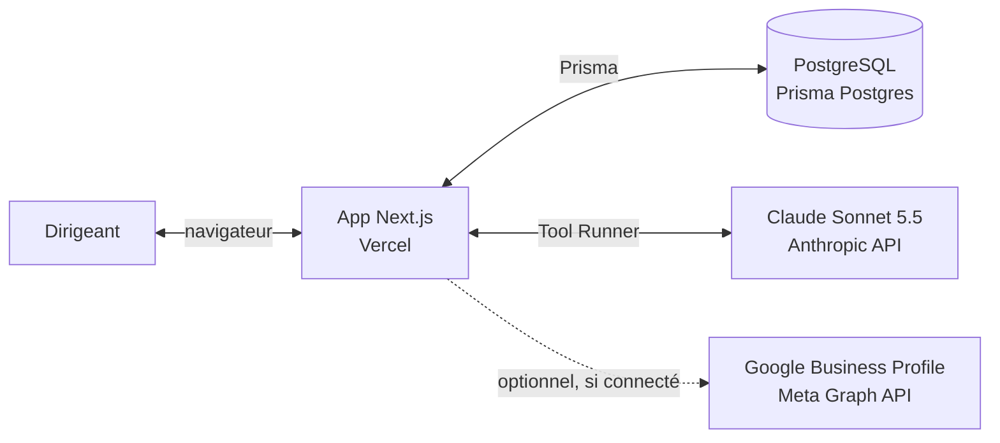
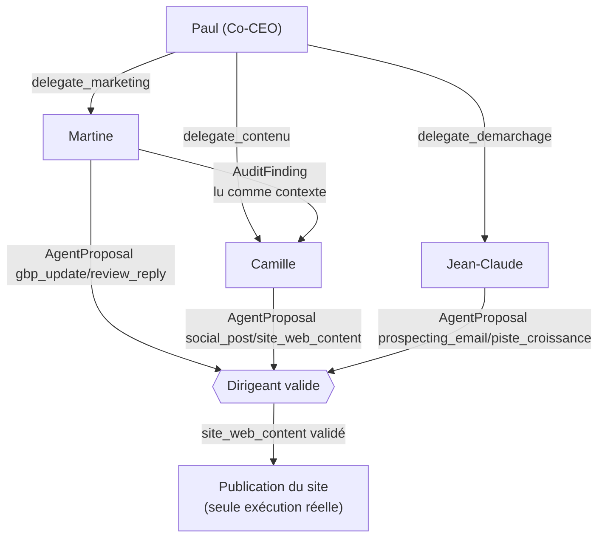
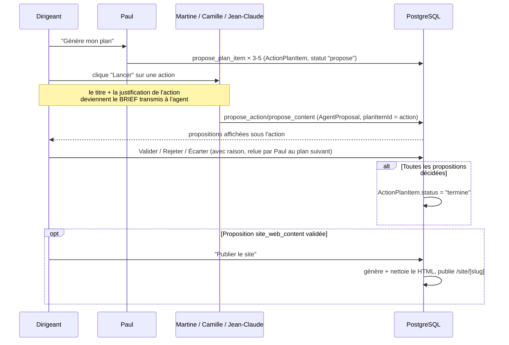
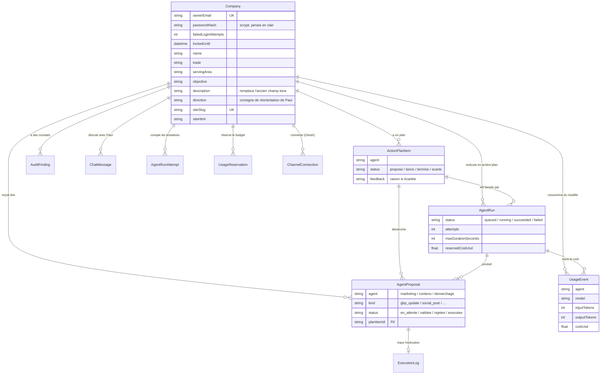
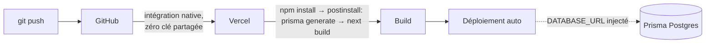

# Architecture Pepito

Document de référence à jour (2026-10-18) — remplace [architecture-technique.md](architecture-technique.md) qui garde la trace de la décision initiale (CTO, avant Postgres/Vercel/réorg agents) à titre historique.

## 1. Vue d'ensemble

Pepito est une application web (Next.js) où un **Co-CEO (Paul)**, orchestré par IA, pilote une petite équipe de **3 agents spécialisés**. Chaque agent **propose** des actions (contenu, diagnostic, pistes commerciales) ; **rien n'est jamais exécuté sans validation explicite du dirigeant**. Les exécutions réelles existantes — publication du site, publication sur la Page Facebook connectée, envoi d'un email Gmail — partent toutes d'une production approuvée et d'une confirmation explicite ; aucune n'est automatique.

## 2. Stack technique

| Couche | Choix | Pourquoi |
|---|---|---|
| Framework | **Next.js 16** (App Router), TypeScript | Full-stack dans un seul projet (pages + API routes), déploiement natif sur Vercel |
| UI | React + Tailwind CSS v4 | Pas de bibliothèque de composants ajoutée — volontairement minimal |
| Base de données | **PostgreSQL** (Prisma Postgres, hébergé par Vercel) | Seul choix viable pour un hébergement serverless (SQLite ne survit pas à un filesystem éphémère) |
| ORM | **Prisma 7** avec `@prisma/adapter-pg` | Driver adapter explicite (obligatoire depuis Prisma 7 — plus d'URL magique dans le schéma) |
| IA | **Claude Sonnet 5.5** (`claude-sonnet-5-5`) via `@anthropic-ai/sdk`, pattern **Tool Runner** | Un seul modèle partout pour l'instant ; chaque agent définit ses propres outils (function calling), la bibliothèque gère la boucle d'appel |
| Auth | Cookie de session **signé HMAC-SHA256** (`SESSION_SECRET`), expiration à 30 jours, `HttpOnly`/`SameSite=Lax`, `Secure` en production ; version de session révocable en base. Mot de passe haché **scrypt** (natif Node, aucune dépendance). | Cookie forgé corrigé le 2026-10-05 ; expiration et révocation étendues par l'US #65 — voir [backlog.md](backlog.md) |
| Hébergement | **Vercel**, déploiement auto sur push GitHub | Zéro configuration CI/CD, intégration GitHub native (aucune clé API partagée) |
| OAuth (optionnel) | Google OAuth2 (Gmail), Meta Graph API (Page Facebook), LinkedIn (connexion du profil) | Gmail et Facebook recettés en production (2026-10-13 et 2026-10-15) ; LinkedIn : connexion seulement, pas de publication ; fiche Google et Instagram non connectés (cf. [oauth-setup.md](oauth-setup.md)) |

## 3. Logique inter-agents

### 3.1 Rôles et garde-fou commun

| Agent | Rôle | Outils (function calling) | Produit |
|---|---|---|---|
| **Paul** (`co_ceo`) | Point de contact, orchestrateur, "meneur" | `get_current_status`, `delegate_marketing`, `delegate_contenu`, `delegate_demarchage`, `record_uncovered_request` (chat), `propose_plan_item` (plan) | Réponses de chat, plan d'action priorisé (`ActionPlanItem`) |
| **Martine** (`marketing`) | Diagnostic + pilotage de la fiche Google. Jamais de contenu créatif. | `web_fetch`, `web_search`, `record_audit_finding`, `propose_action` (gbp_update, review_reply) | `AuditFinding`, `AgentProposal` |
| **Camille** (`contenu`) | Production créative : posts + site web. S'appuie sur les constats de Martine. | `propose_content` (social_post, site_web_content) | `AgentProposal` |
| **Jean-Claude** (`demarchage`) | Pistes de croissance publiques + templates de prospection générique | `web_search`, `propose_growth_lead`, `propose_prospecting_email` | `AgentProposal` |

**Garde-fou non négociable, commun à tous** : chaque outil d'agent **écrit en base** (`create`), il n'appelle **jamais** une API externe. L'exécution réelle est un code séparé (`src/lib/site/publish.ts` pour le site, `src/lib/social/facebook-publish.ts` pour la Page Facebook, la route `/api/gmail/send` pour l'email), déclenché uniquement sur une production déjà approuvée et une confirmation explicite, avec le niveau de risque contrôlé côté serveur.

### 3.4 Lancements persistés et quotas

Les demandes des agents et la génération de plan sont inscrites dans `AgentRun` avant de rendre la réponse HTTP (`202`). Le lancement d'une action de plan la réclame atomiquement (`propose` → `en_cours`) et lie le run, les productions, constats et événements de coût. Une clé unique par entreprise et par clé active évite qu'un double clic ou deux onglets créent deux runs ; les demandes directes identiques sont dédupliquées pendant cinq minutes après succès. Une nouvelle demande est permise ensuite. Une relance d'un échec de plan exige explicitement l'identifiant de ce run.

Le traitement utilise `after()` de Next.js après la réponse, avec `maxDuration=60` sur la route : c'est du travail post-réponse **borné par la durée de la fonction Vercel**, pas une queue indépendante du fournisseur. La base reste la source d'état ; le polling permet de reprendre un run en attente, de constater un dépassement de délai et d'offrir une relance explicite. Une coupure peut laisser des propositions partielles : elles sont liées au run, et les limites de reprise dépendent du résultat déjà produit. Pour une queue durable avec workers indépendants ou tâches plus longues, un fournisseur de queue externe restera nécessaire.

Les plafonds par entreprise sont en UTC : 10 tentatives/jour, 100/mois, 5 USD/jour et 25 USD/mois par défaut, modifiables par un administrateur explicite. Chaque début de tentative est compté, y compris une relance. Les coûts sont calculés par `UsageEvent` avec le barème versionné dans `src/lib/usage.ts`. Un run en cours réserve 1 USD ; un appel synchrone réserve aussi 1 USD jusqu'à l'enregistrement de son coût ou l'expiration de 70 secondes. Les lancements comparent coût enregistré + réservations actives au plafond dans une transaction verrouillée par entreprise. **Ce contrôle applicatif n'est pas un plafond fournisseur Anthropic** : un appel individuel peut coûter plus que sa réservation estimée, et la facturation fournisseur peut être retardée. Garder aussi des alertes/plafonds au niveau du compte fournisseur.

### 3.2 Orchestration par Paul

Camille ne reçoit pas les constats de Martine via un mécanisme de handoff dédié : elle lit simplement les derniers `AuditFinding` en base au moment de son propre run (même table, pas de couplage de code entre les deux agents).

### 3.5 Discussion avec Paul

Le panneau de discussion est accessible de toutes les pages connectées (`src/components/paul-panel.tsx`) ; l'historique est relu côté serveur (50 derniers messages) et le brouillon survit à la navigation. Paul connaît la page ouverte et l'élément consulté (constat, production, prospect), résolu côté serveur dans les seules données de l'entreprise connectée et transmis comme donnée, jamais comme instruction. Quand Paul cite un objet, il ajoute un marqueur typé que le serveur ne transforme en lien interne que si l'objet existe et appartient à l'entreprise (`src/lib/paul-references.ts`).

`POST /api/co-ceo/message` renvoie la réponse en flux NDJSON (`application/x-ndjson`, `src/lib/chat-stream.ts`) quand le client l'annonce dans `Accept`, sinon un JSON unique ; le texte s'affiche au fil de l'eau et la réponse finale, liens résolus, fait foi. Un client déconnecté n'interrompt pas le tour : la réponse est quand même enregistrée.

La voix repose sur l'API Web Speech du navigateur, sans service ni coût côté BienDecider : dictée, lecture à voix haute et échange vocal mains libres (`src/lib/speech.ts`), tous déclenchés par une action explicite. L'audio de la dictée est traité par le service vocal du navigateur ; seul le texte reconnu est envoyé à BienDecider, et seulement quand il est validé par l'envoi du message ou de la demande.

### 3.3 Boucle plan → action → proposition → validation

C'est le parcours central de l'application (page **Aujourd'hui**, anciennement "dashboard") :

Mode manuel (page **Équipe**) : même logique, mais sans passer par le plan — chaque agent est lancé directement, sans brief imposé.

## 4. Modèle de données (entités clés)

**Isolation entre entreprises** : toute route API dérive l'entreprise de la session (`getSessionCompany()`), jamais d'un `companyId` fourni par le client — corrigé après audit le 2026-10-05 (cf. [backlog.md](backlog.md)).

## 5. Sécurité — état actuel

| Sujet | État |
|---|---|
| Session | Cookie signé HMAC-SHA256, vérifié à temps constant (`timingSafeEqual`) |
| Mots de passe | Hachés scrypt + sel, jamais stockés ni renvoyés au client (`omitPasswordHash` systématique) |
| Force brute | 5 échecs → verrouillage 15 min, compteur incrémenté atomiquement en base (valable entre instances serverless) ; en plus, par IP hachée (`x-real-ip`, posée par Vercel) : 20 échecs de connexion / 15 min et 10 inscriptions / h, puis 429 + `Retry-After` (`src/lib/auth-throttle.ts`) ; ignoré si l'IP est absente |
| Isolation multi-tenant | Toutes les routes vérifient l'appartenance via la session, pas via un ID client |
| Entrées des routes API | Corps JSON validé (objet, types, longueurs, montants bornés) ; une entrée invalide renvoie un 400 clair, jamais une erreur serveur (`src/lib/request-body.ts`, schémas zod) |
| Suppression du compte | `POST /api/companies/delete` : mot de passe et confirmation exigés ; effacement en cascade des données et des jetons chiffrés, révocation Google/Meta au mieux avant effacement ; sauvegardes de la base non purgées |
| Contenu généré (site) | HTML nettoyé (scripts/handlers retirés) + servi dans une `<iframe sandbox="">` sans droits |
| OAuth | Jamais de mot de passe tiers collecté — flux OAuth officiel uniquement (Google/Meta) |
| Admin (`/admin`) | **Ouvert par défaut** à tout utilisateur connecté (décision CEO le 2026-10-05) — à refermer via `ADMIN_EMAILS` avant tout client externe non trié sur le volet |

## 6. Déploiement

Variables d'environnement requises en production : `DATABASE_URL` (nom canonique, généralement injecté par Vercel), `ANTHROPIC_API_KEY`, `SESSION_SECRET`. Pour Prisma Postgres, `DATABASE_PRISMA_DATABASE_URL` et `DATABASE_POSTGRES_URL` sont aussi acceptées comme replis si `DATABASE_URL` est absente. Optionnelles : `GOOGLE_OAUTH_*`, `META_*`, `ADMIN_EMAILS`. Détail pas-à-pas dans le [README](../README.md).

## 7. Limites connues (volontaires, pas des oublis)

- **Un seul modèle** (`claude-sonnet-5-5`) partout — choix de coût assumé, à réévaluer par cas si la qualité ne suffit pas (cf. [architecture-technique.md](architecture-technique.md)).
- **Tests** : la CI GitHub lance lint, des tests unitaires sans réseau, le build, puis Playwright sur une base jetée (parcours, sécurité, moteur, connecteurs). Les tests qui écrivent en base ne tournent qu'en CI ou sur une base locale ; aucun test n'appelle les API réelles d'Anthropic, Google ou Meta, donc le flux réel avec le modèle et les consentements fournisseurs se vérifient par recette manuelle.
- **Pas de monitoring d'erreurs** dédié (Sentry ou équivalent, US #83) — seuls les logs serveur Vercel existent aujourd'hui.
- **Connecteurs** : Gmail et la Page Facebook sont recettés en production ; la fiche Google, Instagram et la publication LinkedIn ne sont pas disponibles (démarches externes, cf. [oauth-setup.md](oauth-setup.md)).

Pour le détail complet des décisions prises et de ce qui reste à faire, voir [backlog.md](backlog.md).

