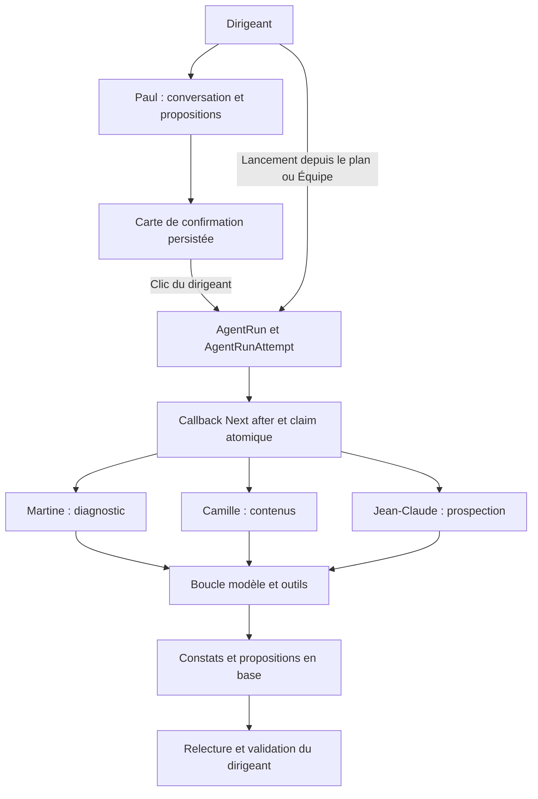

# Audit du code : agents et délégations IA

Date : 24 octobre 2026. Périmètre : agents du produit BienDecider, coordinateur Paul, outils, exécutions, relances, quotas, comptabilité et confirmations. L'installation BMAD sert au développement ; ses workflows ne constituent pas le moteur IA du produit examiné ici.

Analyse du checkout local, dont HEAD était `d3a3c6e` au relevé, en tenant compte des modifications locales en cours de la story 4.1. Ces modifications concernent notamment les quotas séparés de messages et de lancements. Les constats ne supposent pas qu'elles soient déjà déployées. Aucun code applicatif ni statut de sprint n'a été modifié par cet audit.

## Résultat

Huit défauts actionnables : deux P1 sur la maîtrise de la consommation, six P2 sur la cohérence et la reprise. P1 signifie à traiter en priorité ; P2 signifie un défaut réel dont le déclenchement dépend d'un scénario particulier.

Le contrôle humain et le filtrage par entreprise sont présents dans les chemins examinés. Les principaux problèmes portent sur la durée effective des boucles, la conservation des coûts en cas d'erreur et la cohérence entre action, exécution et tentative.

## Architecture observée

Il s'agit d'un coordinateur et de trois exécutants spécialisés, avec une boucle d'outils par exécution. Les spécialistes examinés disposent d'outils de proposition ou de constat ; leurs outils ne publient ni n'envoient directement. La génération du plan et les révisions utilisent aussi le moteur d'exécution. La conversation de Paul passe directement par une réservation d'usage.

Les exécutions sont persistées, mais leur traitement repose sur `after()` dans la requête de lancement ou de suivi. La responsabilité de traitement n'est pas portée par un worker indépendant avec une échéance et un identifiant de tentative imposés à chaque écriture.

## A01 — P1 — La consommation déjà engagée disparaît lorsqu'un tour ultérieur échoue

**Sources :** [usage.ts:75](../src/lib/usage.ts#L75), [boucle en flux:113](../src/lib/usage.ts#L113), [comptabilisation de Martine:213](../src/lib/agents/marketing.ts#L213), [comptabilisation de Paul:677](../src/lib/agents/co-ceo.ts#L677).

Les boucles additionnent l'usage dans des variables locales et ne rendent le total qu'après leur fin normale. Les appels à `recordUsage` interviennent ensuite. Une erreur au deuxième tour, après réception et traitement d'un premier message du modèle, empêche donc l'enregistrement de l'usage du premier tour. Le chemin d'échec du run libère ensuite sa réservation ; pour le chat, la réservation expire sans coût enregistré.

**Déclencheur :** un ou plusieurs tours réussis, puis une erreur réseau, fournisseur ou outil. **Impact :** les dépenses engagées sont absentes de `UsageEvent` ; les prochains contrôles de budget et les coûts affichés sont sous-estimés.

**Reproduction en mémoire :** vraie fonction `runToolLoop`, générateur simulé produisant un message avec 10 000 tokens d'entrée et 1 000 de sortie, puis levant une erreur. Un tour consommé ; aucun total rendu au code de comptabilisation.

**Correction :** enregistrer progressivement l'usage par tour, avec une clé évitant le double comptage, ou préserver et enregistrer le cumul dans le chemin d'erreur. Couvrir aussi la boucle en flux.

## A02 — P1 — Les boucles d'outils n'ont pas de borne globale effective

**Sources :** [construction du runner de Martine:182](../src/lib/agents/marketing.ts#L182), [Camille:109](../src/lib/agents/contenu.ts#L109), [Jean-Claude:216](../src/lib/agents/demarchage.ts#L216), [révision:166](../src/lib/agents/revision.ts#L166), [client Anthropic:3](../src/lib/anthropic.ts#L3).

Les runners fixent `max_tokens` pour chaque réponse, mais aucun `max_iterations`, plafond cumulé ou signal d'annulation lié à la durée de l'exécution. Le SDK installé utilise une boucle `while (true)` et n'applique le plafond d'itérations que lorsqu'il est renseigné : `BetaToolRunner.ts:139` (`node_modules/@anthropic-ai/sdk/src/lib/tools/BetaToolRunner.ts:139`).

**Déclencheur :** le modèle continue à appeler des outils, y compris après un refus de plafond de productions ou de doublon. **Impact :** les propositions sont plafonnées, mais les appels au modèle continuent. La réservation de 1 USD et `maxDurationSeconds` en base ne constituent pas une limite réelle de consommation de la boucle.

**Correction :** imposer un nombre maximal de tours, une échéance propagée au fournisseur et des contrôles de consommation au fil des tours. Définir explicitement l'issue d'une boucle arrêtée après avoir écrit des résultats partiels.

## A03 — P2 — Une ancienne tentative peut encore écrire pendant sa relance

**Sources :** [transition de l'action:51](../src/lib/agents/plan-runner.ts#L51), [protection limitée à la finalisation du run:348](../src/lib/agent-runs.ts#L348), [écriture de Camille:58](../src/lib/agents/contenu.ts#L58).

La finalisation du run vérifie le numéro `attempts`, mais les écritures de productions et la transition finale de l'action ne vérifient pas l'identité de la tentative. Marquer le run périmé n'annule pas le callback ni ses appels d'outils.

**Déclencheur :** un premier worker continue après le délai logique ; le suivi le marque échoué ; le dirigeant relance ; le premier worker reprend et termine. Ce scénario s'applique notamment à un serveur Node qui ne coupe pas automatiquement le callback au délai logique.

**Reproduction en mémoire des vrais modules d'exécution :** pendant la deuxième tentative, `runStatus=running`, `attempts=2`, `actionStatus=en_cours`. Quand l'ancien worker termine, le run reste correctement `running`, mais l'action passe incorrectement à `lance`.

**Impact :** état affiché prématurément terminé, et possibilité d'écritures obsolètes ou de productions supplémentaires. **Correction :** transmettre un identifiant ou numéro de tentative à tous les outils et conditionner leurs transactions, ainsi que la transition de l'action, sur la tentative active.

## A04 — P2 — Une relance peut être déclarée périmée avant de démarrer

**Sources :** [réinitialisation du retry:93](../src/lib/agent-runs.ts#L93), [calcul de péremption:249](../src/lib/agent-runs.ts#L249).

Le retry réinitialise `startedAt` et remet le run en file, mais conserve son `queuedAt` initial. Le suivi utilise `startedAt ?? queuedAt` pour déterminer la péremption.

**Déclencheur :** relance plus de 310 secondes après la première mise en file ; un polling survient avant que le nouveau worker réclame le run. **Reproduction en mémoire :** run remis `queued` avec sa date vieille d'une heure, puis premier polling : `failed`, action remise à `propose`, nouvelle tentative échouée sans exécution.

**Impact :** relance inutilisable et tentative comptée sans démarrage. **Correction :** réinitialiser `queuedAt` dans la transaction de relance, ou calculer l'ancienneté depuis la tentative courante.

## A05 — P2 — Le lancement différé depuis le plan perd une partie de la consigne

**Sources :** [stockage des paramètres dans la carte:408](../src/lib/agents/co-ceo.ts#L408), [lancement depuis le plan:48](../src/app/api/action-plan/[id]/launch/route.ts#L48), [valeur de repli des paramètres:174](../src/lib/agent-runs.ts#L174).

`newsContext` et `prospectDescription` sont conservés dans le payload de la carte, mais pas sur l'action du plan. Après « Plus tard », expiration ou refus de lancement, le bouton du plan lance l'action sans ces paramètres ; le payload de run reçoit `extras: {}`.

**Déclencheur :** demande de prospection ciblant les « Syndics de copropriété », avec titre et brief plus génériques ; carte reportée puis action lancée depuis le plan. **Reproduction en mémoire du vrai handler :** réponse HTTP 202, aucun `extras` transmis à `enqueuePlanRun`, payload final vide. Le ciblage spécifique disparaît. Même problème pour l'actualité transmise à Camille.

**Correction :** persister le brief complet et ses paramètres sur l'action ou un objet de demande durable, puis utiliser cette même source pour tous les points d'entrée.

## A06 — P2 — La reprise via le suivi dispose de 60 secondes pour un run de 300 secondes

**Sources :** [durée de la route de suivi:5](../src/app/api/agent-runs/[id]/route.ts#L5), [reprogrammation depuis le suivi:284](../src/lib/agent-runs.ts#L284), `documentation Next installée` (`node_modules/next/dist/docs/01-app/03-api-reference/04-functions/after.md`).

Le suivi reprogramme un run `queued` avec `after()`. La route déclare `maxDuration = 60`, alors que les routes de lancement et la durée logique des runs utilisent 300 secondes. La documentation Next installée précise que `after()` hérite de la durée de sa route.

**Déclencheur :** le callback de suivi réclame le run avant celui de lancement, ou reprend un run dont le premier callback n'a pas démarré ; le travail dépasse 60 secondes. **Impact sur une plateforme appliquant cette limite :** interruption anticipée, run laissé `running`, puis échec au nettoyage ultérieur.

**Correction :** utiliser le même worker et la même échéance pour les reprises et les lancements ; aligner la durée de route constitue une correction minimale.

## A07 — P2 — Une décision d'écarter peut écraser un lancement concurrent

**Sources :** [lecture du statut:23](../src/app/api/action-plan/[id]/route.ts#L23), [écriture inconditionnelle:41](../src/app/api/action-plan/[id]/route.ts#L41), [transition finale du worker:51](../src/lib/agents/plan-runner.ts#L51).

Le PATCH refuse de modifier une action déjà `en_cours` lors de sa lecture, mais l'UPDATE final ne répète pas cette condition. Un lancement peut revendiquer l'action entre les deux.

**Reproduction en mémoire du vrai handler :** lecture de `propose`, lancement concurrent passant à `en_cours`, puis PATCH : HTTP 200 et action `ecarte`, alors que le run reste lancé. À sa fin, le worker peut remettre l'action à `lance` ou `termine`.

**Impact :** le dirigeant reçoit la confirmation de son refus alors que le travail se poursuit ; son refus peut ensuite disparaître. **Correction :** transition atomique conditionnée sur les statuts autorisés ; zéro ligne modifiée doit produire un conflit.

## A08 — P2 — Un plan vide est annoncé prêt à examiner

**Sources :** [résultat de génération:818](../src/lib/agents/co-ceo.ts#L818), [succès du moteur:348](../src/lib/agent-runs.ts#L348), [message affiché:70](../src/lib/agent-run-progress.ts#L70).

Quand aucun appel à `propose_plan_item` n'a créé d'action, `runCoCeoPlanning` enregistre l'usage puis retourne `[]` normalement. Le moteur enregistre `succeeded` avec `resultCount=0`. Le message de Paul dit toujours que le plan est prêt, sans examiner ce nombre.

**Reproduction en mémoire du vrai module :** modèle renvoyant du texte seul, retour normal avec zéro action, usage enregistré une fois. **Impact :** génération payante sans plan annoncée réussie et dédupliquée pendant cinq minutes.

**Correction :** utiliser `ensureAgentProduced` si un plan vide est un échec ; si « aucune action utile » est un résultat légitime, lui donner un résultat explicite et un message adapté.

## Points d'architecture à suivre séparément

- **Confirmation et mise en file non atomiques.** La carte est confirmée en transaction, puis le lancement se produit hors transaction uniquement après une nouvelle transition. Un arrêt entre ces étapes peut laisser une carte confirmée sans run, sans reprise par un nouveau clic. Voir [pending-actions.ts:250](../src/lib/agents/pending-actions.ts#L250). Prévoir une association durable carte/run et une reprise idempotente.
- **Réconciliation dépendante du suivi individuel.** Le nettoyage des runs périmés est dans `getAgentRun`, pas dans les lectures de liste ou d'état de l'équipe. Un worker interrompu peut laisser une réservation et une action actives tant qu'aucun client ne consulte ce run. Prévoir une réconciliation périodique côté serveur.
- **Mesures des outils serveur ignorées.** Le SDK fournit notamment `server_tool_use.web_search_requests` ; ces champs sont perdus dans l'agrégation d'usage. Leur incidence tarifaire exacte n'a pas été vérifiée dans cet audit. Ne pas considérer le coût enregistré comme une mesure exhaustive de toutes les composantes du fournisseur.
- **Traçabilité des délégations.** Les relations action/run et run/tentatives existent ; l'association carte/run reste dans un payload JSON. Un lien explicite, un identifiant de tour de Paul et un identifiant de tentative dans chaque résultat faciliteraient la supervision.

## Garde-fous observés

- Filtrage des lectures et confirmations par entreprise ; `companyId` capturé côté serveur dans les outils spécialisés examinés.
- Claim du run par un UPDATE conditionnel de `queued` vers `running`.
- Clés uniques d'idempotence et de dédoublonnage ; transactions sérialisables pour les créations et contrôles de quota.
- Plafonds de productions contrôlés par le code, avec sérialisation des appels d'outils d'un même run dans le processus.
- Confirmation humaine des intentions de lancement et validation distincte des productions.
- Révisions protégées par la version et le statut attendus ; destinataire Gmail conservé.

Ces vérifications n'établissent pas l'absence de toute vulnérabilité. Aucune faille d'autorisation permettant une publication externe automatique n'a été démontrée dans les chemins examinés.

## Vérifications réalisées et limites

- `npm run test:delegation` : **62 tests réussis**.
- Six scénarios reproduits en mémoire avec les fonctions ou modules TypeScript réels et des dépendances simulées : perte d'usage partiel, ancienne tentative modifiant l'action, relance immédiatement périmée, paramètres perdus au lancement depuis le plan, course écarter/lancer, génération de plan vide.
- Lecture du SDK Anthropic installé pour la limite d'itérations et de la documentation Next installée pour la durée de `after()`.
- Aucun appel au modèle ni aux fournisseurs externes ; aucune écriture en base. Les tests moteur avec PostgreSQL et la recette avec le vrai modèle n'ont pas été exécutés. Les reproductions en mémoire valident les chemins logiques ; elles ne mesurent pas les fréquences de course sur un déploiement réel.
- Les sources évoluaient dans un autre travail pendant la lecture. Les emplacements des constats ont été relus avant la rédaction ; l'état déployé n'a pas été contrôlé.

## Ordre de correction proposé

1. Préserver l'usage sur chaque issue, borner les tours et propager l'annulation.
2. Introduire un identifiant de tentative opposable à chaque écriture métier ; corriger la date de relance et la durée de reprise.
3. Conserver la demande complète sur l'action et rendre atomiques les décisions de statut.
4. Traiter explicitement le plan vide ; rendre la confirmation et la mise en file récupérables.
5. Ajouter les tests de régression correspondant aux scénarios ci-dessus et une réconciliation serveur indépendante du navigateur.
