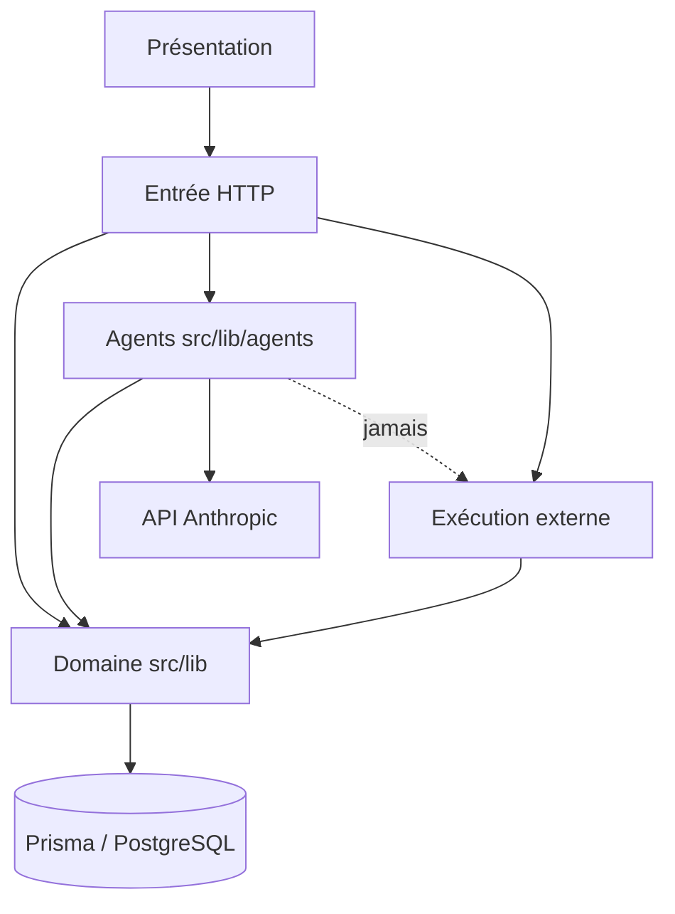

# Architecture Spine — BienDecider (socle existant)

Ce spine ratifie l'existant ; il ne le redécrit pas. Le détail (stack, schéma, flux) reste dans [docs/architecture.md](../../../../architecture.md) et dans le code. Ici ne figurent que les règles qu'une nouvelle story doit respecter pour ne pas diverger.

## Design Paradigm

Monolithe modulaire Next.js App Router, un seul déploiement Vercel.

| Couche | Emplacement | Contient |
| --- | --- | --- |
| Présentation | `src/app/**/page.tsx`, `src/components/` | écrans, panneau de Paul |
| Entrée HTTP | `src/app/api/**/route.ts` | authentification de session, validation zod, appel au domaine ; aucune logique métier |
| Domaine | `src/lib/` | règles métier, statuts, quotas, calculs déterministes |
| Agents | `src/lib/agents/` | prompts, outils (Tool Runner), contexte injecté |
| Persistance | `prisma/schema.prisma`, `src/lib/prisma.ts` | PostgreSQL via Prisma 7 |
| Exécution externe | `src/lib/site/`, `src/lib/social/`, `src/app/api/gmail/send` | publication et envoi, seulement après approbation |

## Invariants & Rules

### AD-1 — Un agent propose, il n'exécute jamais [ADOPTED]

- **Binds:** tous les agents, tout nouvel outil d'agent
- **Prevents:** un agent qui publie, envoie ou modifie un service externe sans décision du dirigeant
- **Rule:** un outil d'agent n'écrit qu'en base (`AgentProposal`, `AuditFinding`, `ActionPlanItem`, `Lead`, `Company` pour les champs que le dirigeant a confirmés). Toute exécution externe part d'une production approuvée et d'une confirmation explicite, dans un code hors boucle agent.

### AD-2 — Tout lancement d'agent passe par AgentRun [ADOPTED]

- **Binds:** chat, plan, onboarding, page Équipe, cron
- **Prevents:** double exécution payante, budget dépassé, run invisible
- **Rule:** lancer un agent = `enqueuePlanRun` ou `enqueueDirectRun` (`src/lib/agent-runs.ts`), qui dédoublonne, contrôle le quota et traite après la réponse. Aucun appel direct à un agent depuis une route sans `AgentRun`.

### AD-3 — Isolation par entreprise [ADOPTED]

- **Binds:** toutes les lectures et écritures
- **Prevents:** fuite de données entre clients, injection via le contexte
- **Rule:** chaque requête filtre sur le `companyId` de la session. Le contexte de page est résolu côté serveur et passé au modèle comme donnée, jamais comme instruction.

### AD-4 — Paul : une conversation, et le plan comme pivot [ADOPTED]

- **Binds:** panneau de Paul, outils de Paul
- **Prevents:** deux fils parallèles (chat et plan) et des productions orphelines
- **Rule:** une seule conversation par entreprise (`ChatMessage`). Toute délégation depuis le chat crée ou reprend une `ActionPlanItem`, et les productions y sont rattachées.

### AD-5 — Chiffres déclarés, calculs déterministes [ADOPTED]

- **Binds:** objectif, profil chiffré, résultats
- **Prevents:** un écart ou un nombre de clients calculé de travers par le modèle
- **Rule:** les champs chiffrés de `Company` sont déclaratifs. Les écarts et besoins sont calculés par `src/lib/business-target.ts` puis injectés dans les prompts. Le modèle ne calcule pas lui-même un chiffre qui s'affiche.

### AD-6 — Erreurs typées, message affichable [ADOPTED]

- **Binds:** routes, outils d'agents, chat
- **Prevents:** message technique montré au dirigeant, ou échec présenté comme réussite
- **Rule:** une erreur métier est une classe typée (`AgentRunConflictError`, `AgentRunQuotaError`, `AgentNoResultError`) qui porte un message affichable. Toute autre erreur devient un message générique et part dans les logs serveur.

### AD-7 — Statuts et version optimiste [ADOPTED]

- **Binds:** plan, runs, productions
- **Prevents:** deux écrans qui interprètent différemment un même état, écrasement concurrent
- **Rule:** les transitions sont `ActionPlanItem` `propose → en_cours → lance | termine | ecarte`, `AgentRun` `queued → running → succeeded | failed`, `AgentProposal` modifiée avec `expectedVersion`. Toute vue de l'état, y compris celle de Paul, lit l'ensemble des statuts actifs.

## Consistency Conventions

| Concern | Convention |
| --- | --- |
| Langue | Textes visibles, prompts et documents en français, vouvoiement, charte [docs/charte.md](../../../../charte.md) |
| Nommage produit | « BienDecider » ; cookies et package restent « pepito » |
| Agents | `co_ceo` (Paul), `marketing` (Martine), `contenu` (Camille), `demarchage` (Jean-Claude) ; personas dans `src/lib/agents/personas.ts` |
| Validation d'entrée | zod dans la route, limites de taille explicites |
| Réponse d'erreur HTTP | `{ error: string }` lisible par le dirigeant, code 4xx/5xx cohérent (409 conflit, 429 quota) |
| Coûts | tout appel modèle passe par `reserveUsageBudget` / `recordUsage` (`src/lib/usage.ts`) |
| Migrations | Prisma, appliquées au déploiement Vercel (`scripts/migrate-on-deploy.cjs`) |
| Tests | Playwright (`tests/*.spec.ts`) et `node --test` ; la CI fait foi sous Windows |

## Stack

| Name | Version |
| --- | --- |
| Next.js | 16.4.0 |
| React | 19.3.0 |
| Prisma / @prisma/client | ^7.10.0 |
| @anthropic-ai/sdk (Tool Runner) | ^0.133.0 |
| Modèle des agents | claude-sonnet-5-5 (`src/lib/anthropic.ts`) |
| zod | ^4.6.5 |
| Tailwind CSS | ^4 |
| Playwright | ^1.64.0 |
| Hébergement | Vercel (projet `bien-decider`), PostgreSQL Prisma Postgres |

## Deferred

- **Queue durable indépendante de Vercel** : les runs restent bornés par la durée de la fonction (300 s). À reprendre si un agent dépasse régulièrement cette limite.
- **Modèle par agent** : un seul modèle pour l'instant. À reprendre après mesure de la qualité par tâche.
- **Exécution réelle sur les autres canaux** (fiche Google, Instagram, LinkedIn) : dépend des accès fournisseurs.

## Écarts constatés à corriger

Ces écarts entre le code et les règles ci-dessus sont repris par l'épopée « Paul fiable » :

1. `getPlanAndFunnelStatus` (`src/lib/agents/chat-context.ts:32`) ne lit que `propose` et `lance` : une action `en_cours` est invisible pour Paul. Cela contredit AD-7.
2. L'onboarding lance Martine par un `fetch` direct en tâche détachée (`src/components/company-profile-form.tsx:142`), hors plan : le plan l'ignore. Cela contredit l'esprit d'AD-4.
3. `delegateThroughPlan` (`src/lib/agents/co-ceo.ts:150`) transforme un conflit ou un quota en « indisponible ». Cela contredit AD-6.
