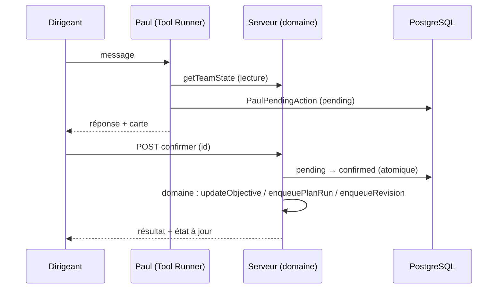
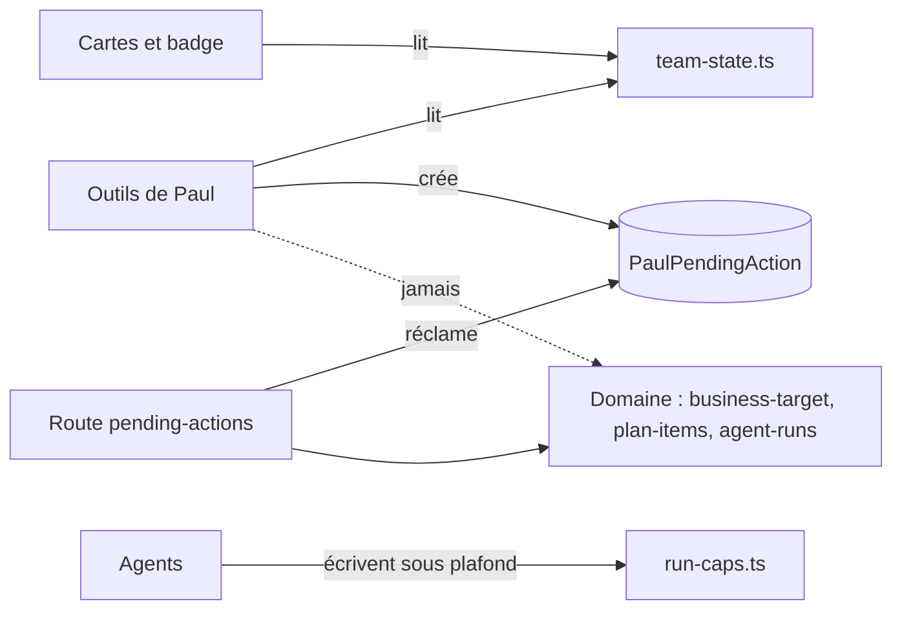
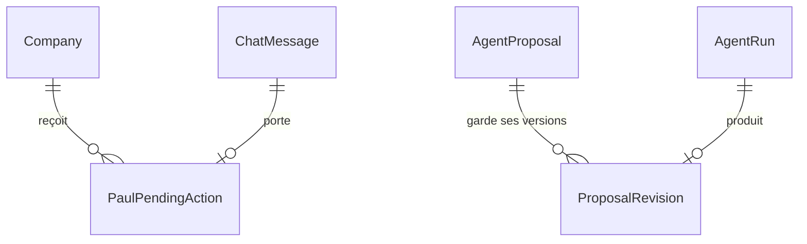

# Architecture Spine — Paul fiable

## Design Paradigm

Le paradigme du socle reste en place. L'épopée y ajoute un motif **intention → confirmation → exécution par le domaine** :



Paul lit et propose. Le domaine écrit, après un clic du dirigeant.

## Inherited Invariants

| Inherited | From parent | Binds here |
| --- | --- | --- |
| AD-1 | spine socle | la révision reste une production à décider ; rien n'est publié ni envoyé |
| AD-2 | spine socle | lancement depuis une carte et révision passent par `AgentRun` |
| AD-3 | spine socle | une carte n'est confirmable que par l'entreprise qui l'a reçue |
| AD-4 | spine socle | une conversation ; les délégations restent rattachées au plan |
| AD-5 | spine socle | l'objectif est converti et calculé par le code, jamais par Paul |
| AD-6 | spine socle | les motifs d'échec sont des erreurs typées avec message affichable |
| AD-7 | spine socle | la lecture d'état couvre tous les statuts actifs, `en_cours` inclus |

## Invariants & Rules

### AD-8 — Toute action de Paul est une intention à confirmer

- **Binds:** FR-1, FR-2, FR-7, FR-9
- **Prevents:** un outil de Paul qui écrit ou lance directement ; un double clic qui exécute deux fois
- **Rule:** les outils de Paul qui modifient quelque chose créent seulement un `PaulPendingAction` (`type` parmi `update_objective`, `update_profile`, `launch_plan_item`, `revise_proposal` ; `payload` validé par zod ; `status` `pending → confirmed | cancelled | expired` ; `chatMessageId` du message de Paul). La confirmation passe par `POST /api/co-ceo/pending-actions/[id]` (`confirm` ou `cancel`). Cette route réclame la transition `pending → confirmed` de façon atomique avant d'appeler la fonction du domaine, la même que celle de l'écran manuel équivalent. Une carte non confirmée expire au bout de 24 h. Une nouvelle intention de même `type` et de même cible annule l'intention `pending` précédente : il n'y a jamais deux cartes actives contradictoires.

### AD-9 — Une seule lecture de l'état de l'équipe

- **Binds:** FR-4, FR-13, FR-14
- **Prevents:** Paul, les cartes d'exécution et le badge qui affichent des états différents
- **Rule:** `getTeamState(companyId)` (`src/lib/team-state.ts`) renvoie :
  - les actions `propose`, `en_cours` et `lance` ;
  - les exécutions des dernières 24 h, avec statut, durée, `resultCount` et `failureReason` ;
  - le nombre de décisions en attente.

  `get_current_status`, les cartes d'exécution, le badge Décisions et l'accueil n'utilisent que cette fonction pour ces trois informations.

### AD-10 — Motifs d'échec typés de bout en bout

- **Binds:** FR-5
- **Prevents:** un conflit ou un quota annoncé comme une panne ; le mot « ÉCHEC » montré au dirigeant
- **Rule:**
  - `RunFailureReason` = `already_running | quota_runs | quota_budget | no_result | outage`.
  - `classifyRunError(error)` (`src/lib/agents/agent-errors.ts`) est le seul point de conversion d'une erreur en motif.
  - Un run échoué enregistre `AgentRun.failureReason`.
  - Tout outil de Paul renvoie un JSON `{ ok, reason?, message, runId?, planItemId? }`, jamais une phrase libre.
  - `already_running` renvoie aussi le `runId` existant.

### AD-11 — Le premier audit naît côté serveur, dans le plan

- **Binds:** FR-6
- **Prevents:** un audit hors plan, invisible pour Paul, lancé en tâche détachée depuis le navigateur
- **Rule:** la création de l'entreprise (`POST /api/companies`, première création) crée l'`ActionPlanItem` de Martine et appelle `enqueuePlanRun` dans la même requête. Le client ne lance plus d'agent.

### AD-12 — Une révision est une nouvelle version de la même production

- **Binds:** FR-9
- **Prevents:** des productions sœurs en doublon ; une version précédente perdue
- **Rule:**
  - Une révision est un `AgentRun` de payload `{ kind: "revision", proposalId, fromVersion, instruction }`, exécuté par l'agent auteur.
  - L'agent dispose d'un outil `revise_proposal` qui met à jour la même `AgentProposal`, avec `version + 1` contrôlé par `fromVersion`.
  - Avant l'écriture, une table `ProposalRevision` (`proposalId`, `fromVersion`, `previousContent`, `instruction`, `agentRunId`) garde la version précédente.
  - Seule une production `en_attente` peut être révisée.
  - La clé de dédoublonnage active est `revision:{proposalId}` : une seconde demande pendant une révision en cours renvoie `already_running`.

### AD-13 — Contexte d'exécution : date et nom du dirigeant

- **Binds:** FR-10, FR-11, FR-15
- **Prevents:** un cache de prompt invalidé chaque jour ; un agent qui ignore la date ou signe à la place du dirigeant
- **Rule:** `runtimeContextLines(company, now)` (date du jour Europe/Paris, `Company.ownerName`) est injecté dans tous les agents, **hors** du bloc système mis en cache (bloc dynamique ou contexte du dernier message). Le titre de Paul vient de `PERSONAS.co_ceo` seulement.

### AD-14 — Plafonds appliqués par le code

- **Binds:** FR-12
- **Prevents:** un plafond qui ne repose que sur le prompt et que le modèle dépasse
- **Rule:** chaque outil d'écriture d'un agent compte ses écritures par `kind` pour l'`AgentRun` courant. Au-delà de la limite (`RUN_CAPS`, `src/lib/agents/run-caps.ts`), il n'écrit pas et répond au modèle que le plafond est atteint.

### AD-15 — L'objectif passe en montant et période

- **Binds:** FR-1, FR-3
- **Prevents:** une conversion mois/an faite par le modèle
- **Rule:** l'outil d'objectif reçoit `{ targetAmount, currentAmount?, period: "month" | "year", targetDate?, averageClientValue?, newClientsPerYear? }`. La conversion vers les champs mensuels existants est faite par `toMonthly` (`src/lib/business-target.ts`) au moment de la confirmation. La carte affiche les valeurs converties.

### AD-16 — Une action active par agent et par thème

- **Binds:** FR-8
- **Prevents:** deux actions Jean-Claude « Prospection » créées par deux tours de chat
- **Rule:** `createChatPlanItem` renvoie l'action existante quand une action `propose` ou `en_cours` du même agent et du même thème existe ; la carte de lancement cible alors cette action.



## Consistency Conventions

| Concern | Convention |
| --- | --- |
| Nommage | `PaulPendingAction`, `ProposalRevision`, `RunFailureReason`, `getTeamState`, `runtimeContextLines`, `toMonthly` |
| Réponse d'outil de Paul | JSON `{ ok, reason?, message, ...ids }` ; `message` en français, affichable |
| Carte dans le chat | rendue depuis `PaulPendingAction` lié au `chatMessageId`, jamais depuis le texte du modèle |
| Migrations | une migration Prisma par story qui touche le schéma, additive (colonnes nullables) |
| Tests | chaque story ajoute un test : Playwright pour les parcours, `node --test` pour les fonctions pures (`toMonthly`, `classifyRunError`, `getTeamState`) |
| Scénario de recette | `tests/paul-fiable.spec.ts` rejoue Atelier Lumen avec un modèle simulé ; SM-1 et SM-2 y sont vérifiés |

## Structural Seed



```text
src/lib/team-state.ts            # AD-9
src/lib/agents/run-caps.ts       # AD-14
src/lib/agents/pending-actions.ts # création et exécution des intentions (AD-8)
src/app/api/co-ceo/pending-actions/[id]/route.ts
```

## Capability → Architecture Map

| FR | Lives in | Governed by |
| --- | --- | --- |
| FR-1, FR-2, FR-3 | `pending-actions.ts`, `business-target.ts`, page Entreprise | AD-8, AD-15, AD-5 |
| FR-4, FR-13, FR-14 | `team-state.ts`, cartes d'exécution, badge | AD-9, AD-7 |
| FR-5 | `agent-errors.ts`, `agent-runs.ts`, `co-ceo.ts` | AD-10, AD-6 |
| FR-6 | `api/companies/route.ts`, `company-profile-form.tsx` | AD-11, AD-2 |
| FR-7, FR-8 | `co-ceo.ts`, `plan-items.ts`, `pending-actions.ts` | AD-8, AD-16 |
| FR-9 | `agent-runs.ts` (payload revision), outils des agents, `ProposalRevision` | AD-12, AD-1 |
| FR-10, FR-11, FR-15 | `personas.ts`, prompts des agents, onboarding, Entreprise | AD-13 |
| FR-12 | `run-caps.ts`, outils d'écriture des agents | AD-14 |

## Deferred

- **Similarité sémantique entre actions** (au-delà agent + thème) : à reprendre si des doublons de sujet subsistent après AD-16.
- **Affichage riche de l'historique de versions** : la story FR-9 montre la version précédente ; une comparaison côte à côte est différée.
- **Diffusion en temps réel de l'état** (push) : le polling existant suffit.
- **Diagnostic du 503 de « Préremplir mon profil »** : hors épopée.
